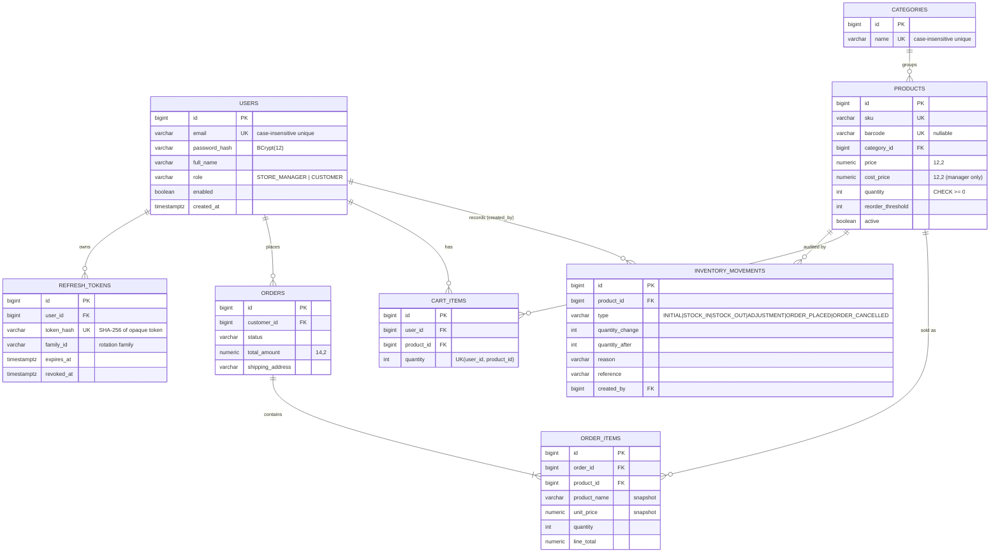

# StockPilot – Store Inventory Management System

A full-stack inventory and ordering system for a small store.

* **Store managers** manage products, categories, stock (audited), reports and customer orders.
* **Customers** register, browse the catalogue, fill a server-side cart, place orders and track them.

Spring Boot 4 + PostgreSQL on the back end, React 19 + TypeScript on the front end, JWT authentication with rotating refresh tokens, and role-based authorization enforced by the API (the UI is never the security boundary).

---

## 1. Features

| Area | What is implemented |
| --- | --- |
| Auth | Login, customer registration, JWT access token (15 min) + rotating HttpOnly refresh cookie, logout/revocation, refresh-token reuse detection, brute-force rate limiting, `/me` |
| Roles | `STORE_MANAGER`, `CUSTOMER` (`ROLE_*` authorities). No public manager registration; first manager is bootstrapped from environment variables |
| Products | CRUD (delete = deactivate), unique SKU / optional unique barcode, search (name/SKU/barcode), category + stock-status filters, sorting, pagination, `BigDecimal` money |
| Categories | CRUD; deletion refused (409) while products still reference the category |
| Inventory | Stock-in, stock-out, absolute adjustments with reason/reference; every change writes an immutable `inventory_movements` row; negative stock is impossible (service rule + DB `CHECK`); row-level pessimistic locking |
| Reports | Inventory + valuation, low-stock, out-of-stock, movement history (date/product/category/type filters), order summary, manager dashboard |
| Catalogue | Customer-facing endpoints that never expose cost price or reorder thresholds |
| Cart & orders | Server-side cart; checkout recalculates everything from DB prices, locks products in id order, decrements stock atomically; order items keep purchase-time prices; cancellation restores stock exactly once; manager status workflow (`PLACED → CONFIRMED → PROCESSING → SHIPPED → DELIVERED`, cancel before shipping) |
| UI | Responsive layouts, mobile drawer, role-specific navigation, protected/role routes, forms with Zod validation, data tables, pagination, confirm dialogs, toasts, loading/empty/error states |

Payments are **not** integrated: an order is a basic order-management workflow and no payment is processed or claimed.

---

## 2. Technology stack and versions

Versions were checked on **2026‑10‑18** against the official release channels (Maven Central for the JVM stack, the npm registry for the front end) and the exact versions below are what was built and tested.

### Backend

| Component | Version | Notes |
| --- | --- | --- |
| Java | **21 (LTS)** | built/tested on OpenJDK 21.0.11 |
| Spring Boot | **4.1.1** (GA) | latest GA; `4.2.0-M2` is a milestone and deliberately not used |
| Spring Framework / Security | 7.0.9 / 7.1.1 | managed by Boot |
| Hibernate ORM | 7.4.5.Final | managed by Boot |
| Flyway | 12.4.0 (+ `flyway-database-postgresql`) | managed by Boot |
| JWT | Nimbus JOSE+JWT 10.9.1 via Spring Security OAuth2 Resource Server | HS256; maintained, first-class Spring Security integration, so no extra JWT library to keep in sync |
| springdoc-openapi | 3.1.1 | the 3.x line targets Spring Boot 4 |
| PostgreSQL | 17 (Docker image `postgres:17-alpine`), JDBC driver 42.7.13 | |
| Testing | JUnit 6.0.3, Mockito 5.23, Spring Boot Test, Testcontainers 2.0.5 | |
| Maven | 3.9.16 via the committed Maven Wrapper (`./mvnw`) | no local Maven required |

### Frontend

| Component | Version |
| --- | --- |
| React / React DOM | 19.3.1 |
| TypeScript | 7.0.2 |
| Vite / `@vitejs/plugin-react` | 8.3.4 / 6.1.2 |
| React Router | 7.18.4 (`react-router-dom`) |
| Axios | 1.20.0 |
| Tailwind CSS (`@tailwindcss/vite`) | 4.3.3 |
| React Hook Form / Zod / resolvers | 7.90.0 / 4.6.7 / 5.9.2 |
| Lucide icons | 1.59.0 |
| Vitest / jsdom / Testing Library | 4.1.12 / 27.4.0 / RTL 16.3.3, user-event 14.6.8, jest-dom 6.9.1 |

**Version decisions worth knowing**

* **Vitest 4.1.12, not 5.x; jest-dom 6.9.1, not 7.x.** Vitest 5 and jest-dom 7 declare `node >=22`. The project targets **Node.js ≥ 20.19** (the minimum for Vite 8), so the latest releases that run on Node 20 were chosen. On Node 22+ you can upgrade both without code changes. The Docker image builds with Node 22.
* **Nimbus (Spring Security) instead of a separate JWT library.** It is what Spring Security's resource server uses, is actively maintained, and avoids Jackson 2/3 coupling issues that Spring Boot 4 introduced for third-party JWT libraries.
* All versions are pinned exactly (no `^`/`~` in `package.json`; Maven versions come from the Boot BOM, with springdoc pinned explicitly). No SNAPSHOT/milestone/RC dependencies are used.

### Prerequisites

| Tool | Version |
| --- | --- |
| JDK | 21 |
| Node.js / npm | ≥ 20.19 (22 LTS recommended) / ≥ 10 |
| Docker + Compose v2 | any recent (required for the Dockerised run **and** for backend integration tests, which start PostgreSQL via Testcontainers) |
| PostgreSQL | 17 if you run the backend without Docker (any ≥ 14 works) |
| Maven | not needed – use `./mvnw` |

---

## 3. Architecture

```
┌────────────┐   /api (same origin)   ┌────────────────────────────┐      ┌────────────┐
│ React SPA  │ ─────────────────────▶ │ Spring Boot modular monolith│ ───▶ │ PostgreSQL │
│ (nginx/    │ ◀───────────────────── │ Controller → Service → Repo │      │  (Flyway)  │
│  Vite dev) │   JSON + refresh cookie│ Spring Security + JWT       │      └────────────┘
└────────────┘                        └────────────────────────────┘
```

Backend packages (`com.store.inventory`): `config`, `security`, `auth`, `user`, `category`, `product`, `inventory`, `order` (cart + orders), `report`, `exception`, `common`. DTOs are Java records next to their feature; JPA entities never leave the service layer. Controllers contain no business logic. One global `@RestControllerAdvice` produces a consistent error body:

```json
{ "timestamp": "…", "status": 400, "error": "Bad Request", "message": "Validation failed", "path": "/api/products", "fieldErrors": { "sku": "…" } }
```

Frontend (`frontend/src`): `api/` (Axios client + typed services), `context/` (auth, cart, toasts), `routes/` (guards), `layouts/`, `components/` (reusable UI kit), `pages/` (public, `manager/`, `customer/`), `hooks/`, `types/`, `utils/`.

The browser talks to a **single origin**: the Vite dev proxy in development and nginx in Docker forward `/api` to Spring Boot. This keeps the `SameSite=Strict` refresh cookie working and removes the need for CORS (CORS is still configured explicitly for the origins in `CORS_ALLOWED_ORIGINS`).

### Concurrency design

* Every stock change goes through `InventoryService.applyChange`, which takes a `PESSIMISTIC_WRITE` row lock on the product, rejects results `< 0`, updates the quantity and inserts the movement in one transaction.
* Checkout locks all products of the cart in **ascending id order** (no deadlocks), re-validates availability from the locked rows, then writes the order and one `ORDER_PLACED` movement per line. Cancellation locks the order row, so stock can only be restored once.
* `Product` uses `@DynamicUpdate`, so editing a product's name/price never overwrites a concurrently changed quantity.
* A DB `CHECK (quantity >= 0)` is the last line of defence. Integration tests prove 10 simultaneous checkouts for 3 units yield exactly 3 orders.

---

## 4. Entity-relationship diagram



Schema lives in `backend/src/main/resources/db/migration` (Flyway, `V1__init_schema.sql`). Hibernate runs with `ddl-auto=validate`, so the schema is reproducible purely from migrations. Indexes cover email, product name/category/active, movement product/date, order customer/status/date.

---

## 5. Authentication and authorization flow

1. `POST /api/auth/login` (or `/register`) → Spring Security's `AuthenticationManager` (DAO provider + BCrypt) validates the credentials. The response body contains a **15‑minute HS256 JWT** (`iss`, `sub`=user id, `exp`, `jti`, `role`, `typ=access`) and the user; a **random 384‑bit refresh token** is set as an `HttpOnly`, `SameSite=Strict`, `Path=/api/auth` cookie (`Secure` when `COOKIE_SECURE=true`). Only the SHA‑256 hash of the refresh token is stored.
2. The SPA keeps the access token **in memory only** and sends it as `Authorization: Bearer`. On any 401 the Axios interceptor performs **one shared** `POST /api/auth/refresh` (single-flight), retries the request once, and logs the user out if the refresh fails – there is no retry loop.
3. Refresh **rotates** the token: the old one is revoked and a new one issued in the same family. Presenting an already-rotated token is treated as theft and **revokes the whole family**. Logout revokes the family and clears the cookie.
4. On page load the SPA calls refresh to restore the session; nothing protected renders until the backend has answered.
5. Spring Security validates signature, expiry, issuer and `typ` on every request. 401 = unauthenticated/invalid token, 403 = authenticated but lacking the role. Roles are read from the **signed token**, never from request data; registration always creates `CUSTOMER`.
6. Authorization is layered: URL rules in `SecurityConfig` (`/api/manager/**`, `/api/inventory/**`, `/api/reports/**`, `/api/products/**` → manager) **plus** `@PreAuthorize` on controllers, plus service-level ownership checks (a customer asking for someone else's order gets 404).

**Token storage trade-off:** an access token in JS memory is lost on reload (restored through the refresh cookie) and cannot be read from `localStorage` by an XSS payload at rest; the long-lived credential is `HttpOnly` so scripts cannot read it. XSS can still *use* the in-memory token while the page is open, which is why the lifetime is short and a CSP at the proxy is recommended for production.

**CSRF:** the API is stateless and bearer-authenticated, so Spring's session-CSRF filter is disabled intentionally (there is no ambient credential to forge). The only cookie-authenticated endpoints (`/api/auth/refresh`, `/api/auth/logout`) require a custom `X-Requested-With` header (impossible for a cross-site form post and subject to a CORS pre-flight for cross-origin XHR) and the cookie is `SameSite=Strict` and path-scoped.

**Rate limiting:** failed logins are counted per *client IP + email* (default 5 per 15 min) and per IP (5×); beyond that the API returns `429` with `Retry-After`. It is in-memory (single instance). Behind several replicas, also rate-limit at the gateway/WAF.

---

## 6. Environment variables

Copy `.env.example` to `.env` (git-ignored) for Docker Compose; export the same variables when running the backend directly.

| Variable | Default | Description |
| --- | --- | --- |
| `DB_URL` | `jdbc:postgresql://localhost:5432/store_inventory` | JDBC URL |
| `DB_USERNAME` / `DB_PASSWORD` | `store` / **required** | DB credentials |
| `JWT_SECRET` | **required** | Base64 key, ≥ 32 bytes: `openssl rand -base64 48`. The app refuses to start without it |
| `JWT_ISSUER`, `JWT_ACCESS_TTL` | `store-inventory`, `PT15M` | issuer claim, access-token lifetime |
| `REFRESH_TOKEN_TTL` | `P7D` | refresh-token lifetime |
| `COOKIE_SECURE` | `true` | set `false` only for plain-HTTP local use |
| `COOKIE_SAME_SITE` | `Strict` | |
| `CORS_ALLOWED_ORIGINS` | `http://localhost:5173` | comma-separated explicit origins |
| `LOGIN_MAX_ATTEMPTS`, `LOGIN_WINDOW` | `5`, `PT15M` | brute-force limiter |
| `FORWARD_HEADERS_STRATEGY` | `none` | `native` when behind a trusted reverse proxy (Docker Compose sets it) |
| `MANAGER_EMAIL`, `MANAGER_PASSWORD`, `MANAGER_NAME` | empty | bootstrap manager (below) |
| `SERVER_PORT` | `8080` | |
| `VITE_API_URL` (frontend) | `/api` | **public** – baked into the browser bundle, never put secrets in it |

---

## 7. Initial manager account

There is deliberately **no endpoint** to create managers. On startup the backend creates one if `MANAGER_EMAIL` and `MANAGER_PASSWORD` (12–72 characters) are set **and no user with that email exists**. It never overwrites an existing account.

```bash
export MANAGER_EMAIL=you@yourstore.example
export MANAGER_PASSWORD='a-long-unique-passphrase'
```

Remove `MANAGER_PASSWORD` from the environment after the first start. Nothing in the repository contains a default credential; `.env.example` ships an empty password. Additional managers must be inserted by an administrator (e.g. a one-off SQL/DB task) – a managed user-administration feature is listed under limitations.

---

## 8. Run it

### A. Docker (everything)

```bash
cp .env.example .env
# edit .env: set DB_PASSWORD, JWT_SECRET (openssl rand -base64 48), MANAGER_EMAIL, MANAGER_PASSWORD
docker compose up --build
```

* App: http://localhost:3000 (nginx → SPA, `/api` proxied to the backend)
* API + Swagger UI: http://localhost:8080/swagger-ui.html (OpenAPI JSON at `/v3/api-docs`)
* Postgres is bound to `127.0.0.1:5432`.

Compose waits for PostgreSQL (`pg_isready`), then the backend (`/actuator/health/readiness`), then starts nginx; Flyway applies migrations on backend start. `docker compose down -v` also deletes the data volume.

### B. Backend alone

```bash
# PostgreSQL (example)
docker run -d --name store-pg -e POSTGRES_DB=store_inventory -e POSTGRES_USER=store \
  -e POSTGRES_PASSWORD=devpassword -p 5432:5432 postgres:17-alpine

cd backend
export DB_PASSWORD=devpassword
export JWT_SECRET=$(openssl rand -base64 48)
export COOKIE_SECURE=false            # plain HTTP on localhost
export MANAGER_EMAIL=manager@example.com MANAGER_PASSWORD='choose-a-12+char-password'
./mvnw spring-boot:run                # JAVA_HOME must point to JDK 21
```

### C. Frontend alone

```bash
cd frontend
npm install
npm run dev        # http://localhost:5173 – proxies /api to http://localhost:8080
```

Set `VITE_DEV_PROXY_TARGET` to proxy somewhere else. If you set `VITE_API_URL` to an absolute URL on another origin you must add the frontend origin to `CORS_ALLOWED_ORIGINS` and make sure the cookie settings fit (`SameSite=Strict` requires same-site).

---

## 9. Tests

```bash
# Backend – unit + integration. Integration tests start PostgreSQL 17 with Testcontainers (Docker must be running)
cd backend && ./mvnw test

# Frontend
cd frontend
npm test              # Vitest + React Testing Library
npm run typecheck     # tsc
npm run build         # type-check + production build
```

Results of the last run on this machine (2026‑10‑18):

| Suite | Result |
| --- | --- |
| Backend (JUnit 6, PostgreSQL 17 via Testcontainers) | **41 tests, 0 failures** – `AuthIntegrationTest` 12, `OrderIntegrationTest` 9, `ProductInventoryIntegrationTest` 7, `AuthorizationIntegrationTest` 6, `InventoryServiceTest` 4, `DomainRulesTest` 3 |
| Frontend (Vitest) | **41 tests, 0 failures** across 7 files; `tsc` clean; production build succeeds |

Backend integration tests exercise the real Spring Security chain with real JWTs against PostgreSQL (not mocked): login success/failure, validation errors, forged/expired/wrong-issuer/wrong-key/non-access tokens, refresh rotation, reuse detection, logout, rate limiting, customer denial on **every** manager endpoint, cost-price non-disclosure, duplicate SKU/barcode, stock in/out/adjust + audit rows, negative-stock prevention, concurrent stock-outs and concurrent checkouts, order ownership, cancellation stock restoration (exactly once), status-transition rules, valuation maths. Frontend tests cover login validation/success/failure/loading, route guards (including "no protected render while loading"), role-based navigation, product listing/search/filters/empty/error/loading states, product form validation, cart totals, and the Axios single-flight refresh (no loops).

---

## 10. API reference

Interactive docs: **Swagger UI `http://localhost:8080/swagger-ui.html`** (use *Authorize* with the access token from `/api/auth/login`).
Unless stated, endpoints need a valid bearer token. Lists accept `page` (0-based), `size` (≤ 100) and whitelisted `sortBy`/`direction`.

| Method & path | Access | Purpose |
| --- | --- | --- |
| `POST /api/auth/login` | public | email + password → access token, user, sets refresh cookie |
| `POST /api/auth/register` | public | create a **customer** account (returns session) |
| `POST /api/auth/refresh` | refresh cookie + `X-Requested-With` | rotate refresh token, new access token |
| `POST /api/auth/logout` | cookie + `X-Requested-With` | revoke token family, clear cookie |
| `GET /api/auth/me` | any role | current user |
| `GET/PUT /api/profile`, `PUT /api/profile/password` | any role | own profile / password |
| `GET /api/catalog`, `GET /api/catalog/{id}` | any role | active products, **no cost price**. Filters: `q`, `categoryId`, `stockStatus` |
| `GET /api/categories` | any role | list (with product counts) |
| `POST/PUT/DELETE /api/categories[/{id}]` | manager | manage; delete → 409 if in use |
| `GET /api/products`, `GET /api/products/{id}` | manager | incl. cost price. Filters: `q` (name/SKU/barcode), `categoryId`, `stockStatus`, `active` |
| `POST /api/products`, `PUT /api/products/{id}` | manager | create (optional `initialQuantity`) / update (quantity not editable here) |
| `DELETE /api/products/{id}` | manager | **deactivate** (history is kept; reactivate via PUT `active=true`) |
| `GET /api/inventory` | manager | stock levels (active products) |
| `POST /api/inventory/stock-in`, `/stock-out` | manager | `{productId, quantity, reason?, reference?}` |
| `POST /api/inventory/adjustments` | manager | `{productId, newQuantity, reason, reference?}` |
| `GET /api/inventory/movements` | manager | filters `productId`, `categoryId`, `type`, `from`, `to` (ISO dates) |
| `GET /api/inventory/low-stock` | manager | `0 < qty ≤ reorder threshold` |
| `GET /api/reports/inventory` | manager | totals + valuation page (`categoryId`, `q`, `stockStatus`) |
| `GET /api/reports/low-stock`, `/out-of-stock`, `/inventory-movements`, `/orders` | manager | reports (orders: `from`,`to`) |
| `GET /api/manager/dashboard` | manager | totals, recent movements and orders |
| `GET/POST /api/cart`, `/api/cart/items`; `PUT/DELETE /api/cart/items/{productId}`; `DELETE /api/cart` | customer | server-side cart |
| `POST /api/orders` | customer | place order **from the cart** (`shippingAddress`, `notes?`); client totals are ignored |
| `GET /api/orders/my-orders` | customer | own orders |
| `GET /api/orders/{id}` | customer (own) / manager | order detail |
| `POST /api/orders/{id}/cancel` | customer (own, `PLACED` only) | cancel + restore stock |
| `GET /api/manager/orders` | manager | filters `status`, `q`, `from`, `to` |
| `PATCH /api/manager/orders/{id}/status` | manager | `{status}` – validated transitions; `CANCELLED` restores stock |
| `GET /actuator/health` | public | liveness/readiness |

Business rules: **low stock** = `0 < quantity ≤ reorder_threshold`; **out of stock** = `quantity = 0`; **valuation** = `quantity × current cost_price` of active products (not FIFO/average cost); retail value uses the selling price.

---

## 11. Sample workflows

1. **Stock a new product** – manager signs in → *Products → Add product* (opening stock becomes an `INITIAL` movement) → *Stock adjustment* to receive a delivery (`STOCK_IN`, reference `PO-1042`) → *Movement history* shows the audit row.
2. **Customer purchase** – register → *Catalogue* → add items → *Cart* → *Checkout*. Stock is decremented immediately; *My orders* shows `PLACED`.
3. **Fulfil an order** – manager → *Orders* → `Confirmed → Processing → Shipped → Delivered`. Cancelling before shipping returns stock and writes `ORDER_CANCELLED` movements.
4. **Spot shortages** – dashboard alert → *Reports → Low stock* → *Restock* shortcut.

---

## 12. Known limitations

* No payment gateway, tax, shipping rates or email notifications; orders are a simple workflow.
* Stock is decremented at order placement (not on confirmation); customers can cancel only while `PLACED`.
* Only the bootstrap manager is provisioned automatically; there is no UI for managing additional manager/staff accounts, password reset by email, or account lockout administration. Registration does not verify email addresses and reveals whether an email is already registered (HTTP 409).
* The login rate limiter is in-memory and per instance; use a shared limiter/gateway for multi-instance deployments.
* A disabled user stays authenticated until the access token expires (≤ 15 min); the next refresh is refused.
* Role is embedded in the JWT, so a role change takes effect after the token expires.
* Product images, barcode scanning, multi-warehouse stock and CSV export are not implemented.
* Reports are paginated tables; there is no chart rendering or file export.
* The initial console shows one harmless `401` for `/api/auth/refresh` when an anonymous visitor opens the app (it is the session-restore probe).
* The UI is English/USD only.

---

## 13. Security considerations

* Passwords: BCrypt (cost 12), 8–72 chars with letter + digit for customers; bootstrap manager ≥ 12 chars. Password hashes, refresh tokens and secrets never appear in responses or logs (logs contain user ids and emails only).
* `JWT_SECRET` and DB credentials come only from the environment; the app fails fast on a missing/short secret. Rotate the secret to invalidate all access tokens.
* Run behind **HTTPS** in production, set `COOKIE_SECURE=true`, and add HSTS/CSP headers at the reverse proxy. nginx here sets `X-Content-Type-Options`, `X-Frame-Options`, `Referrer-Policy`.
* `FORWARD_HEADERS_STRATEGY=native` must only be used behind a proxy you control that overwrites `X-Forwarded-For`; otherwise clients could spoof their IP and evade the rate limiter.
* Customers can never reach manager data: URL-level rules, method security, DTO separation (`CatalogProductDto` has no cost fields) and ownership checks are all enforced server-side and covered by tests.
* Swagger UI is enabled for development convenience; disable it (`springdoc.swagger-ui.enabled=false`, `springdoc.api-docs.enabled=false`) in production if the API is public.
* Postgres is published on `127.0.0.1` only in Compose; remove the mapping if you do not need host access.
* The Docker backend runs as a non-root user.
* `docker-compose.yml` and `.env.example` contain no real secrets; `.env` is git-ignored.

---

## 14. Troubleshooting

| Symptom | Fix |
| --- | --- |
| Backend exits: `JWT_SECRET must be set` / `at least 32 bytes` | `export JWT_SECRET=$(openssl rand -base64 48)` |
| Backend: `password authentication failed` / connection refused | check `DB_URL`/`DB_PASSWORD`; the pool retries for 60 s so start the database first |
| Integration tests error with *Could not find a valid Docker environment* | start Docker Desktop; Testcontainers needs the daemon |
| Login works but you are logged out on reload (HTTP) | set `COOKIE_SECURE=false` – browsers drop `Secure` cookies on plain HTTP (except `localhost` in some browsers) |
| Always logged out / `403 Missing X-Requested-With` on refresh | the frontend must be served from the same origin as `/api` (use the dev proxy or nginx); check `VITE_API_URL` |
| CORS errors in the browser | add the exact frontend origin to `CORS_ALLOWED_ORIGINS` (scheme + host + port) |
| `429 Too many failed login attempts` | wait for `Retry-After` seconds or restart the backend (in-memory counters) |
| `npm install` ERESOLVE / EBADENGINE warnings | use Node ≥ 20.19 (22 LTS recommended) and the committed `package-lock.json` |
| `Port already in use` | change `FRONTEND_PORT`, `BACKEND_PORT`, `DB_PORT` in `.env` |
| Reset everything | `docker compose down -v` (deletes the database volume) |
